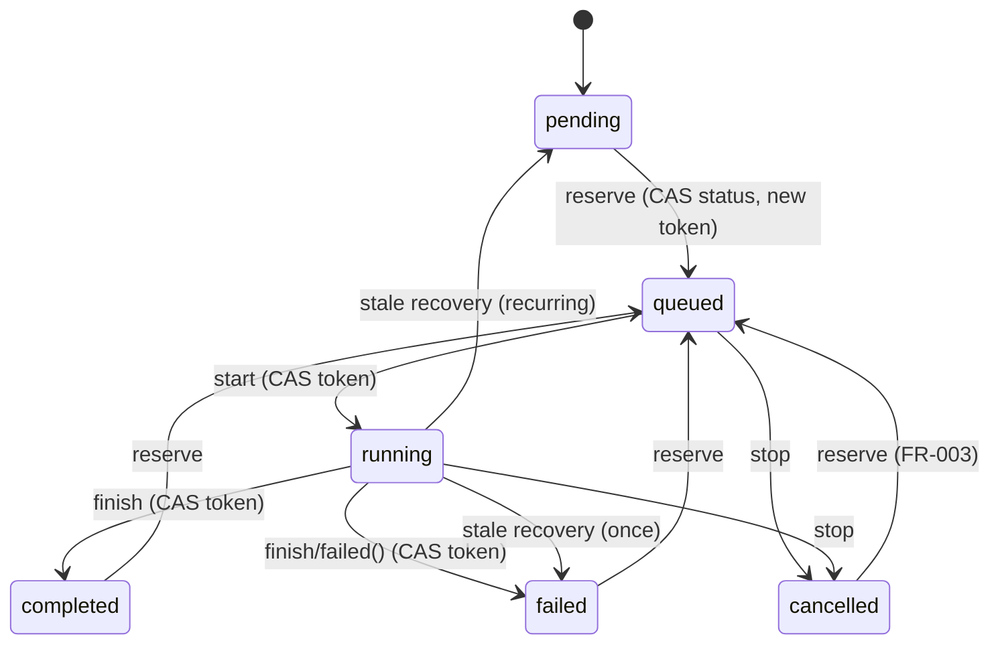

# Design

## 1. Модель состояний задачи



Правило: **каждый** переход — один `UPDATE` с условием. Владение = знание текущего токена.

## 2. Новые компоненты

| Компонент | Ответственность | Заменяет |
| :--- | :--- | :--- |
| `Tasks\Execution\TaskStateMachine` | Все CAS-переходы (`reserve`, `start`, `heartbeat`, `progress`, `finish`, `cancel`, `recover`). Возвращает `bool`. | `TaskStateWriter`, прямые `update()` в job/service/engine |
| `Tasks\Scheduling\ScheduleCalculator` | Чистая функция `nextRunAt(task, from): ?CarbonImmutable` | `isDailyTaskDue`, `isIntervalTaskDue` |
| `Tasks\Execution\StepRunner` | Выполнение одного шага → `StepOutcome` (completed/skipped/failed) + лог | 3 копии try/catch в `SequenceStepExecutor` и `TaskExecutionService` |
| `Tasks\Execution\SequenceRunner` | Цикл шагов с бюджетом, heartbeat, delay, hand-off; один движок для sync и queue | `executeInlineSequence` + цикл в `ExecuteScheduledTaskJob` |
| `Game\Zone\ZoneCacheInvalidator` (interface + impl) | Инвалидация кэша home/friend зон | статические `ApplyBuffHandler::invalidate*` |
| `Exceptions\SessionBusyException` | Лок AMF не получен (retryable) | «Proceeding without lock» |

`StepOutcome` / `StepResultCollection` уже существуют — переиспользовать, а не удалять.

## 3. CAS-пример

```php
public function finish(ScheduledTask $task, string $token, TaskStatus $to, string $summary, array $payload): bool
{
    return ScheduledTask::whereKey($task->id)
        ->where('execution_token', $token)
        ->update([
            'status' => $to,
            'last_result' => $summary,
            'payload' => $payload,
            'execution_token' => null,
            'completed_steps' => 0,
            'last_run_at' => now(),
            'next_run_at' => $this->calculator->nextRunAt($task, now()), // ADR-003: от окончания
            'is_active' => $task->schedule_type === ScheduleType::Once ? false : $task->is_active,
        ]) === 1;
}
```

## 4. Схема (аддитивно)

| Колонка | Тип | Назначение |
| :--- | :--- | :--- |
| `next_run_at` | `timestamp null`, индекс `(is_active, next_run_at)` | Детерминированное расписание |
| `heartbeat_at` | `timestamp null` | Liveness, отдельно от `queued_at` |

`scheduled_for` не вводится: по ADR-003 база интервала — окончание запуска.

Backfill: `next_run_at` вычисляется `ScheduleCalculator` из текущих полей
(`last_run_at`, `created_at`, `run_at_time`, `run_at_datetime`).

## 4a. Пропущенные слоты (ADR-002)

`ScheduleCalculator` — чистые функции без I/O:

```php
nextRunAt(ScheduledTask $task, CarbonImmutable $from): ?CarbonImmutable;   // после окончания
isMissed(CarbonImmutable $nextRunAt, CarbonImmutable $now, int $graceMinutes): bool;
nextFutureSlot(ScheduledTask $task, CarbonImmutable $now): ?CarbonImmutable; // для пропуска
```

Тик планировщика:

```
due = is_active AND next_run_at <= now AND status NOT IN (queued, running)
for each due:
    if isMissed(next_run_at, now, grace):
        CAS: next_run_at = nextFutureSlot(...), last_result = "[Skipped] missed slot",
             once → is_active=false, status=failed
        log warning
    else:
        reserve()
```

Сдвиг — тоже CAS по `next_run_at` (условие `WHERE next_run_at = ?`), чтобы два
планировщика не сдвинули слот дважды.

## 5. Очереди и воркеры (ADR-004: оба режима)

Единый источник: `config('game.queues')` → `['tasks' => 'tso-tasks', 'accounts' => 'tso-accounts', 'market' => 'tso-market', 'default' => 'default']`.

| | Docker (`queue`) | OSPanel (`cron`) |
| :--- | :--- | :--- |
| Планировщик | `scheduler`: `schedule:work` → `tso:run-scheduler` | Windows Task Scheduler / cron: `schedule:run` раз в минуту → `tso:run-scheduler --work` |
| Воркер | `worker`: `queue:work redis --queue=<из конфига> --timeout=150 --tries=1 --max-time=3600` | встроенный `queue:work --queue=<из конфига> --stop-when-empty --max-time=50` |
| `pcntl` | есть (`Dockerfile`) | нет → `$timeout` не применяется |
| Задержка старта | ≤ 5 с | ≤ 60 с |

- `routes/console.php`: флаг `--work` передаётся только при `scheduler_mode=cron`
  (сейчас передаётся всегда → в Docker работают **два** воркера на одних очередях; это допустимо,
  но лишнее и увеличивает риск A-02).
- Docker-воркер получает список очередей из env `TSO_WORKER_QUEUES` с дефолтом, совпадающим с конфигом;
  тест проверяет, что дефолт в `docker-compose.yml` совпадает с `config('game.queues')`.
- `config/queue.php`: `redis.retry_after = 200`, `database.retry_after = 200` (> 150 + margin).
- `ExecuteScheduledTaskJob`: `$tries = 1`, `$timeout = 150`, `failOnTimeout = true`.
- В режиме `cron` без `pcntl` защита от зависания: `http_timeout` у каждого cURL + бюджет 45 с +
  heartbeat/stale recovery.

## 6. Сессии AMF

- `HttpTsoClient::sendCommand()`: `LockTimeoutException` → `SessionBusyException`; TTL лока = `http_timeout * 3 + 10`.
- `ActionRetryPolicy`: `SessionBusyException` → ожидание + retry без relogin.
- Удалить relogin из `TsoAmfService::sendServerCall()`; `SessionExpiredException` пробрасывается в `ActionRetryPolicy`.
- `invalidateSession()` больше не вызывает `forgetClientId()` (проверить на живом сервере — см. verification V-11).
- `ensureZoneLoaded()` использует `GameResponseValidator` для кода ошибки.

## 7. Совместимость

- API-контракт задач не меняется, кроме 409 на «Run now» для busy-задачи (frontend уже блокирует кнопку при busy — проверить).
- `TaskStateWriter` удаляется после миграции всех вызовов (WP-04), а не раньше.
